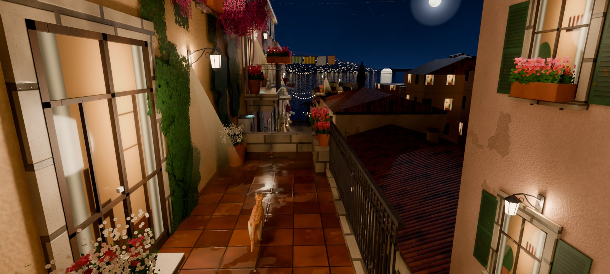

# Cats

Мобильная игра про кота для Android (Unity 6, URP, горизонтальный экран).

## Готовый APK

Каждое изменение в `CatsGame/` собирается на GitHub автоматически (Unity 6, свет запекается на сервере, ~40 минут):
**Actions → Build APK →** последний зелёный запуск **→ Artifacts → CatsMoonStreet-apk**.
Нужны секреты репозитория `UNITY_LICENSE` (весь текст `C:\ProgramData\Unity\Unity_lic.ulf`), `UNITY_EMAIL`, `UNITY_PASSWORD`.

## Состав репозитория

- [`docs/unity-setup.md`](docs/unity-setup.md) — **с чего начать:** пошаговая установка Unity и запуск игры (в редакторе и на телефоне).
- [`CatsGame/`](CatsGame/README.md) — Unity-проект. Открыть в Unity 6 LTS, затем меню **Cats ▸ 0** и **Cats ▸ 4**.
- [`docs/level-01/`](docs/level-01/README.md) — дизайн-документ уровня 1 «Лунная улица»: план, высоты, механики, свет, ассеты, бюджет.
- [`docs/coop-hotspot.md`](docs/coop-hotspot.md) — план кооператива на двух телефонах через точку доступа.
- `tools/` — генераторы: текстуры (numpy), 3D-модели (Blender `bpy`), раскладка уровня (JSON), предварительный рендер (Cycles), проверка компиляции C#.

