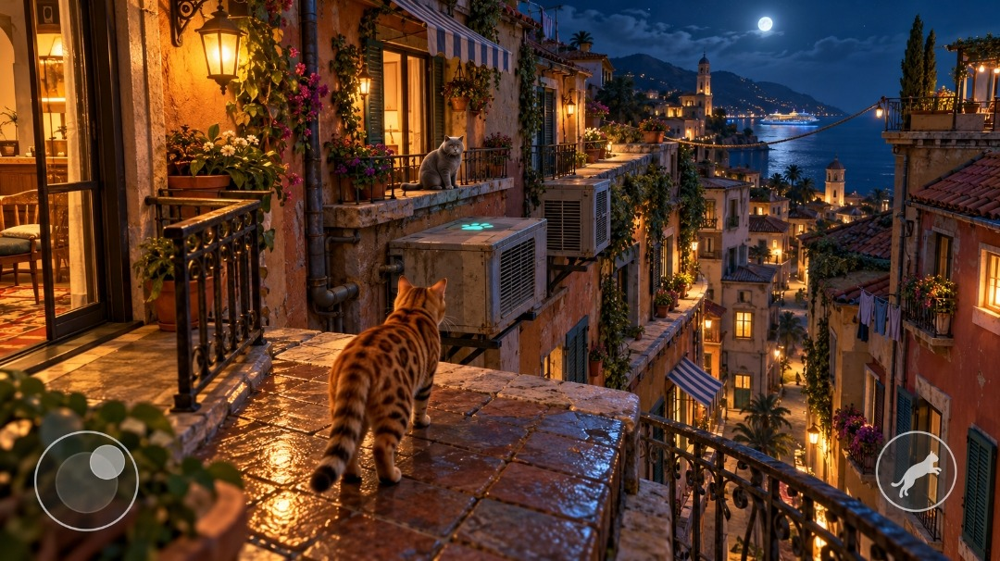
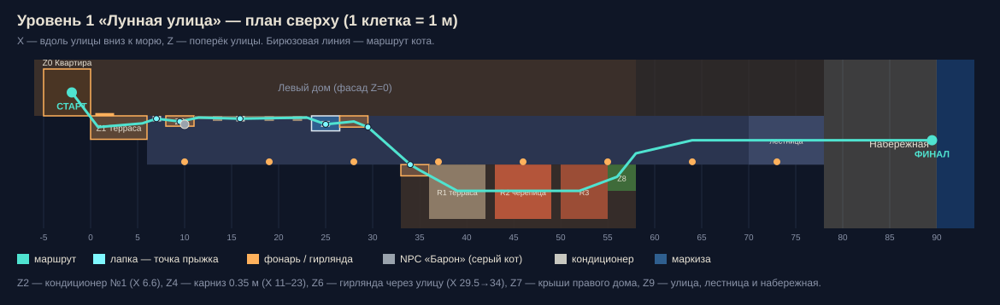
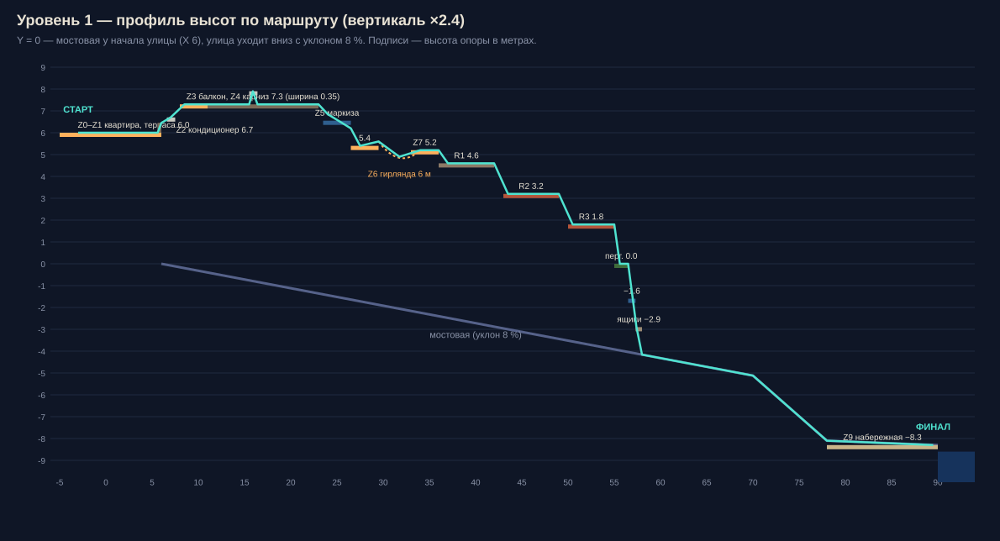

# Уровень 1 — «Лунная улица»

Дизайн-документ первого уровня мобильной игры про кота (Android, Unity 6 + URP).



> Концепт выше — **эталон**. Первый кадр игры должен совпадать с ним по ракурсу камеры,
> свету, ширине террасы и улицы. Всё, что видно на картинке и выглядит проходимым
> (терраса, кондиционер, балкон с серым котом, карнизы, маркизы, гирлянда, крыши справа),
> — проходимо.

---

## 1. Суть уровня

| | |
|---|---|
| **Время суток** | Ночь после дождя, полнолуние |
| **Место** | Средиземноморский городок, узкая улица спускается к морю |
| **Цель игрока** | Выбраться с террасы и по балконам, карнизам и крышам добраться до набережной |
| **Длина маршрута** | ≈ 95 м, перепад высот ≈ 14 м (с 6.0 до −8.3) |
| **Время прохождения** | 5–7 минут |
| **Роль в игре** | Обучение: ходьба, прыжок, узкий карниз, скольжение, канат, спуск |
| **Ощущение** | Уют, тёплый свет, «город спит, а кот гуляет» |

**Завязка (черновик).** Кот выходит на мокрую после дождя террасу. С соседнего балкона
его зовёт серый кот Барон: «Внизу у причала рыбаки разбирают ночной улов, успей, пока
не ушла лодка». Лайнер и огни набережной видны с первого кадра. Это визуальная цель, к
которой игрок идёт весь уровень.

---

## 2. Система координат и масштаб

- **1 юнит Unity = 1 метр**, реальный масштаб.
- **X** — вдоль улицы, вниз к морю. **Z** — поперёк улицы: фасад левого дома на `Z = 0`,
  правого на `Z = 5.2`. **Y** — высота.
- `Y = 0` — мостовая в начале улицы (`X = 6`). Улица уходит вниз с уклоном **8 %**,
  дальше идёт лестница к набережной.
- Кот (бенгальский): длина тела ≈ 0.5 м (с хвостом ≈ 0.85 м), высота в холке ≈ 0.3 м.

### План сверху



### Профиль высот



---

## 3. Зоны уровня

Высоты Y — уровень поверхности, на которой стоит кот.

| Зона | Что это | X (м) | Z (м) | Y (м) | Механика / задача |
|---|---|---|---|---|---|
| **Z0** | Квартира, стеклянная дверь | −5…0 | −5…0 | 6.0 | Стартовая катсцена: кот выходит через приоткрытую дверь |
| **Z1** | Терраса с мокрой плиткой | 0…6 | 0…2.5 | 6.0 | Обучение ходьбе. Каменный парапет 0.45 м, ширина 0.4 м, по нему можно ходить |
| **Z2** | Кондиционер №1 с бирюзовой лапкой | 6.6…7.5 | 0…0.6 | 6.7 | **Первый прыжок**: зазор 0.6 м, вверх 0.7 м |
| **Z3** | Балкон с серым котом Барон | 8.0…11.0 | 0…1.1 | 7.3 | Диалог с NPC, первый чекпоинт |
| **Z4** | Карниз фасада | 11…23 | 0…0.35 | 7.3 | Узкий карниз, кот идёт медленно. Подоконники (глубина 0.55) на X 13.5 / 19 / 22 — места для отдыха. Кондиционер №2 (X 15.5–16.4, верх 7.9) — запрыгнуть и спрыгнуть. Горшки можно уронить |
| **Z5** | Полосатая маркиза → балкон | 23.5…29.5 | 0…1.6 | 6.9→6.2, балкон 5.4 | Спрыгнуть на маркизу, съехать, прыгнуть на нижний балкон |
| **Z6** | Гирлянда через улицу | 29.5 → 34 | 1.2 → 5.2 | 5.6 → 4.9 (провис) → 5.2 | Канатоходец: баланс стиком, 6 м над улицей |
| **Z7** | Балкон и крыши правого дома | 33…55 | 5.2…11 | 5.2 → 4.6 → 3.2 → 1.8 | R1 — плоская терраса с бельём; R2 — черепица и трубы; R3 — нижняя крыша. Спуск ступенями ≤ 1.5 м |
| **Z8** | Спуск во двор кафе | 55…58 | 5.2…8 | 0.0 → −1.6 → −2.9 → −4.2 | Пергола с виноградом → навес кафе → ящики → мостовая |
| **Z9** | Улица, лестница, набережная | 58…92 | 0…5.2 | −4.2 → −8.3 | Свободный бег. Финал у перил над морем |

**Чекпоинты:** Z1 (старт), Z3 (Барон), конец Z4, Z5 (нижний балкон), Z7 (терраса R1), Z9 (низ лестницы).

---

## 4. Управление и параметры кота

Управление как на концепте: **виртуальный джойстик слева**, **кнопка прыжка справа**
(иконка прыгающего кота). Камера поворачивается свайпом по правой половине экрана.

| Параметр | Значение | Комментарий |
|---|---|---|
| Шаг (отклонение стика < 50 %) | 1.2 м/с | |
| Бег (стик до упора) | 3.5 м/с | |
| Карниз | 0.8 м/с | Скорость ограничена, прыжок отключён, кроме прыжков по лапкам |
| Свободный прыжок | вверх 1.0 м / вперёд 2.0 м | |
| **Прыжок по лапке** | вверх до 1.8 м / вперёд до 3.0 м | Если в конусе 60° перед котом есть точка-лапка, кнопка прыжка точно приземляет на неё |
| Автозабирание | уступ ≤ 0.5 м | Без нажатия кнопки |
| Безопасное падение | ≤ 4 м | Ниже — затемнение и возврат на чекпоинт (без «смерти») |
| Койот-тайм / буфер прыжка | 0.12 с / 0.15 с | Прыжки ощущаются отзывчивыми |
| Зацеп когтями | при срыве с края | Кот повисает на краю, стик вверх — забраться |

**Лапки-подсказки.** Бирюзовые светящиеся лапки, как на кондиционере в концепте:
emissive-декаль, мягко пульсирует (период 1.5 с) и видна в темноте.
На уровне 1 лапка есть у **каждого** обязательного прыжка. В следующих уровнях они
становятся реже.

**Защита от случайных падений.** Перила террасы и балконов непроходимы (невидимые
коллайдеры по высоте перил). Падение возможно только на карнизе, маркизе, гирлянде и крышах.

---

## 5. Камера

Первый кадр должен повторять концепт: камера сзади-сверху, кот в нижней трети кадра,
слева дверь квартиры, справа улица уходит к морю, луна в правом верхнем углу.

| Параметр | Значение |
|---|---|
| Тип | Cinemachine 3 — `CinemachineThirdPersonFollow` |
| Дистанция до кота | 2.6 м (карниз: 2.0 м) |
| Высота над котом | 1.4 м |
| Наклон вниз | ≈ 22° |
| FOV (вертикальный) | 50° (на экране 20:9) |
| Сглаживание | Damping 0.3 / 0.3 / 0.5 |
| Коллизии | `CinemachineDeoccluder`, камера не уходит в стены |
| Стартовый ракурс | Позиция (−1.0, 7.5, 1.6), взгляд на точку (8, 6.2, 1.5) |

На гирлянде (Z6) камера смещается вбок, чтобы была видна глубина улицы под котом.
Там это главный «вау-кадр» уровня.

---

## 6. Свет и атмосфера

Главное в концепте — **контраст тёплого и холодного**: оранжевые фонари и окна против
сине-фиолетовой ночи и моря.

### Источники

| Источник | Цвет | Режим | Примечание |
|---|---|---|---|
| Луна (directional) | `#9DB8FF`, ≈ 7500 K | Mixed (Shadowmask) | Слабая, интенсивность 0.25–0.35. Длинные тени от перил |
| Настенные фонари | `#FFA54A`, ≈ 2200 K | Baked + 2–4 ближайших realtime без теней | Фонарь у двери — ключевой свет первого кадра |
| Окна (emissive) | `#FFC27A` | Emissive в лайтмапы | Тёплый свет из квартиры падает на террасу |
| Уличные фонари | `#FFB060` | Baked | Через каждые 9 м, их видно с высоты |
| Гирлянда | `#FFD08A` | Emissive + bloom | Лампочки — частицы или меш, без реальных источников |
| Небо / окружение | верх `#0B1630`, горизонт `#2A3F6B` | Ambient (gradient) | |

### Мокрые поверхности

- Плитка террасы: метакарта влажности. В лужах smoothness 0.9, на сухих участках 0.35.
  Альбедо в мокрых местах темнее на 20 %.
- Отражения: **box-projected reflection probes** (терраса, каждый балкон, улица).
  На мощных телефонах для террасы включается **planar reflection** (только Z1).
- Капли с маркиз и перил — лёгкие частицы (≤ 200 на экране).

### Постобработка (URP Volume)

| Эффект | Настройка |
|---|---|
| Tonemapping | ACES |
| Bloom | Threshold 1.0, Intensity 0.6, Scatter 0.7 |
| Split Toning | тени `#2B4A80`, светлые места `#FFB060`, баланс −20 |
| Color Adjustments | Contrast +12, Saturation +8 |
| Vignette | 0.25 |
| Depth of Field | Выкл. Только на мощных телефонах: Gaussian, для дальнего плана |
| Туман | Linear, `#1A2540`, 40–300 м |

---

## 7. Дальний план (то, что не надо делать в 3D)

| Слой | Дистанция | Как сделано |
|---|---|---|
| Ближний | 0–40 м | Полное 3D, лайтмапы, детали |
| Средний | 40–150 м | Упрощённые 3D-дома (LOD2), запечённый свет, окна — emissive-атлас |
| Дальний | 150 м+ | Matte painting на цилиндре вокруг уровня: холмы, огни города, колокольня, маяк |
| Море | — | Простой шейдер: прокрутка двух normal map, лунная дорожка через specular |
| Лайнер | — | Плоская модель с emissive-огнями, медленно плывёт (≈ 0.3 м/с) |
| Луна | — | Спрайт с ореолом в skybox, всегда в правом верхнем углу стартового кадра |

---

## 8. Наполнение сцены (ассеты)

| Категория | Что нужно | Приоритет |
|---|---|---|
| Кот-герой | Бенгальский кот, PBR, ≈ 15–25k треугольников. Анимации: idle, шаг, бег, прыжок (старт / полёт / приземление), карниз, канат, падение, зацеп, сидеть | **A** |
| NPC Барон | Серый британец, idle-анимации, сидит / смотрит / зевает | A |
| Модульный фасад | Стены с штукатуркой (3–4 цвета), окна со ставнями, двери, карнизы, подоконники, водосточные трубы | **A** |
| Балконы | Кованые перила (2–3 вида), каменные плиты, ящики с цветами | A |
| Кондиционеры | 2 модели, с решёткой и кронштейнами | A |
| Маркизы | Полосатые: бело-синяя, бело-зелёная | A |
| Растительность | Плющ (декали + карточки), бугенвиллея, герани в горшках, пальмы, кипарисы | B |
| Крыши | Черепица, трубы, бельевые верёвки с бельём (ткань с анимацией ветра) | B |
| Свет | Настенные фонари, уличные фонари, гирлянда | A |
| Текстуры | Мокрая плитка, штукатурка, камень, черепица, кованое железо | **A** |
| Дальний план | Matte painting 8k × 2k, море, лайнер | B |

**Где брать (с лицензией для коммерческой игры):**
- Текстуры и HDRI: **Poly Haven**, **ambientCG** — CC0, бесплатно.
- Модели города и пропсы: Unity Asset Store, пакеты в средиземноморском или итальянском стиле.
- Кот: Asset Store или заказать у 3D-художника. От анимаций кота зависит больше половины ощущения от игры.
- Лицензию каждого ассета проверяем до того, как он попадёт в репозиторий.

---

## 9. Бюджет производительности

| | Средний телефон (Snapdragon 7-й серии) | Флагман (Snapdragon 8 Gen 2+) |
|---|---|---|
| FPS | 30 стабильно | 60 |
| Разрешение рендера | 0.75 от экрана + FSR/upscale | 1.0 |
| Треугольники в кадре | ≤ 300k | ≤ 600k |
| Draw calls (SRP Batcher) | ≤ 150 | ≤ 250 |
| Realtime-источники | 2 | 4 |
| Лайтмапы | 3 × 2048, ASTC 6×6 | 4 × 2048 |
| Отражения | только reflection probes | + planar reflection на террасе |
| Bloom | ½ разрешения | полное |
| Тени | Shadowmask, тень кота — blob-декаль | + realtime-тень кота от ближайшего фонаря |
| Текстуры | ASTC 6×6, кот и терраса 2k, остальное ≤ 1k | ASTC 4×4 для кота |

Минимальная версия Android: 9.0 (API 28), Vulkan с откатом на OpenGL ES 3.2.

---

## 10. Звук

- Фон: далёкий прибой, шелест пальм, ночные цикады, редкие капли.
- Отдалённая музыка из кафе внизу: становится громче при спуске (Z8–Z9).
- Шаги кота: разные звуки для мокрой плитки, камня, жести кондиционера, черепицы и ткани маркизы.
- Гирлянда: скрип провода и звон лампочек при раскачивании.
- Упавший горшок в Z4: звук разбитой керамики и ругань соседа из окна (юмор).

---

## 11. Структура Unity-проекта

```
Assets/_Project/
  Art/            модели, материалы, текстуры (по зонам: Terrace, Facade, Roofs, Far)
  Audio/
  Prefabs/        Cat, Npc_Baron, JumpMarker, Checkpoint, модули фасада
  Scenes/
    Level01_MoonStreet.unity
    Level01_MoonStreet_Lighting.unity   (lighting-сцена, грузится аддитивно)
  Scripts/
    Cat/          CatController, CatJump, LedgeWalk, RopeBalance, ClawGrab
    Camera/
    Level/        JumpMarker, Checkpoint, FallZone, LevelExit
    UI/           VirtualJoystick, JumpButton
  Settings/       URP-ассеты Low / High, Volume-профили
```

Пакеты: URP, Input System, Cinemachine 3, ProBuilder (для серой геометрии), TextMeshPro.

---

## 12. План работ

| Этап | Результат | Критерий готовности |
|---|---|---|
| **M1. Серая геометрия** | Весь маршрут из ProBuilder-блоков по размерам из раздела 3 | Уровень проходится от старта до финала |
| **M2. Кот** | Контроллер, прыжки по лапкам, карниз, канат, зацеп, камера | Прохождение без единой «нечестной» смерти, на телефоне ощущается приятно |
| **M3. Свет** | Запечённый свет, пробы, постобработка на серой геометрии | Скриншот стартового кадра по свету и цвету узнаётся как концепт |
| **M4. Арт** | Замена блоков на модули фасадов, пропсы, растения, дальний план | Сравнение «концепт / игра» бок о бок |
| **M5. Оптимизация** | Профили качества Low / High, профилирование на 2 реальных устройствах | 30 / 60 FPS по таблице раздела 9 |
| **M6. Полировка** | Звук, частицы, диалог с Бароном, катсцены старта и финала | Уровень можно показывать |

---

## 13. Открытые вопросы

1. Имя главного героя и пол кота?
2. Будет ли у кота мяуканье или «действие» (отдельная кнопка), например, чтобы будить соседей или отвлекать собак в следующих уровнях?
3. Собираем ли коллекционные предметы (рыбки, колокольчики)? Если да, на уровне 1 их 3 штуки, спрятаны на R1, за кондиционером №2 и под перголой.
4. Ориентация экрана: только горизонтальная (как на концепте)? Предлагаю да.
